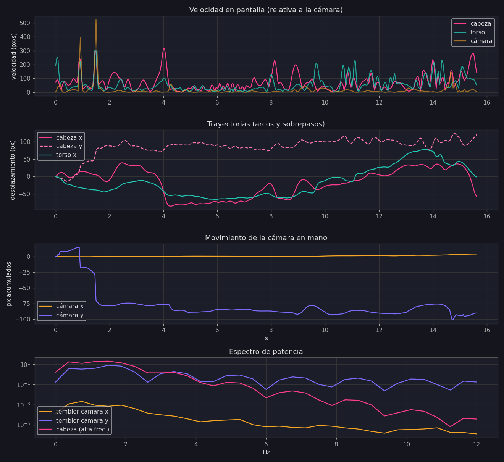

# Análisis del movimiento del video de Benly (@benlyanimations)

Video: 15.7 s, 1706×720, 24 fps. Se midió en cada cuadro con `analisis_mov.py` (NumPy/SciPy, sin IA):

- **Cámara:** correlación de fase entre cuadros (fuera del personaje) → traslación global.
- **Cabeza y torso:** seguimiento por correlación cruzada normalizada con plantilla adaptativa.
- **Audio:** transcripción con Whisper large‑v3 (local) + energía y espectro cada 0.25 s.

## Lo que dicen los números

| Medida | Valor | Qué significa |
|---|---|---|
| Velocidad de la cabeza "en reposo" | ~18 px/s (en 568 px de ancho) | Nunca se congela: siempre hay respiración, peso y mirada |
| Arranque de un movimiento | 0.08–0.13 s | Empieza rápido (casi sin "ease in") |
| Frenado | 0.3–0.8 s, hasta 2–4× el arranque | Llega rápido y se asienta despacio |
| Rebote al llegar | ζ ≈ 0.2–0.45 | Resorte subamortiguado: un pequeño "pasarse y volver" |
| Picos de velocidad | 140–315 px/s | Gestos claros, no lentos ni robóticos |
| Espectro de la cabeza | energía en 0.3–2 Hz, cae ~1000× a 6 Hz | Movimiento suave, sin vibración rápida |
| Cámara en mano | deriva lenta 0.75 Hz (x) / 1.5 Hz (y), sin temblor fino | Operador tranquilo, no "terremoto" |
| Música | ninguna (silencios a −50/−60 dB) | Solo voz, risa y foley |

## Otra perspectiva: el cuerpo como sistema masa‑resorte‑amortiguador

En vez de pensar la animación como "poses + interpolación" (lo que hacía la versión anterior), se modela
como **control motor**: el animador (o el cerebro) da un *objetivo* y cada segmento del cuerpo lo
persigue con inercia:

  x'' = ω² (objetivo − x) − 2ζω x'

- **ω (rigidez):** qué tan rápido responde. Piernas y cadera rígidas (ω≈22–24), brazos y cabeza más
  sueltos (ω≈14–17).
- **ζ (amortiguamiento):** cuánto rebota. Medido ζ≈0.3–0.45 en cabeza y brazos; las piernas casi no
  rebotan (ζ≈0.8) para que los pies no "patinen".
- **Acción superpuesta (follow‑through):** como cada segmento tiene su propio ω y ζ, los codos y la
  cabeza llegan un poco después que el hombro y el torso, igual que en el video y en add‑ons como
  *Actions & Stuff*.
- **Curva "natural":** 14 % de anticipación (−5 %), luego arranque rápido y frenado largo (potencia
  3.2), que reproduce la asimetría medida.
- **Vida:** cambio de peso entre piernas (0.11 Hz), respiración, micro‑movimientos de cabeza con ruido
  suave y sacadas de los ojos cada 0.9–2.8 s.
- **Voz → cabeza:** la envolvente de la voz (30 por segundo) mueve la cabeza en cada sílaba; con una
  skin sin boca, eso es lo que "vende" que está hablando.

Todo esto está en `js/motor.js` (tabla `RESORTES`) y se puede apagar con "Movimiento suave (física)".

## Guion y sonido del original

| Tiempo | Original | Réplica (LTezla, voz "Leo") |
|---|---|---|
| 0.0–1.0 | "¡Hola!" | "¡Hola!" (emocionado) |
| 1.2–2.9 | "No los había visto." | igual |
| 3.4–4.3 | "¿Sí?" | igual |
| 4.5–8.0 | risa | risa (ElevenLabs v3 `[laughs]`) |
| 8.5–10.3 | "Me presento." | igual |
| 10.3–11.5 | "Soy Zita" | "Soy LTezla" |
| 11.5–15.2 | "y los invito a acompañarme a algo maravilloso." | igual |
| 0.3, 10–15 | golpes graves (pasos, manejo de cámara) | ropa/cámara, pasos, agarre de cámara (ElevenLabs efectos) |
